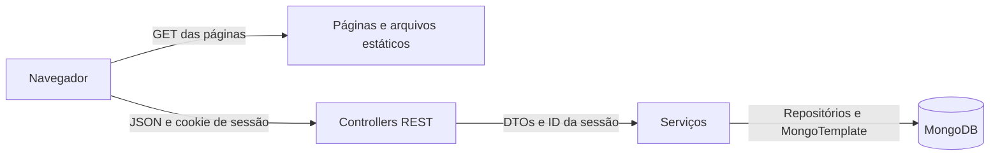

# Arquitetura e modelo de dados

[Voltar ao índice](README.md)

O MediCare é uma aplicação web monolítica. O Spring Boot entrega as páginas e a API REST na mesma origem. O navegador usa HTML, CSS e JavaScript, e o MongoDB armazena as informações. O projeto tem como alvo o Java 17 e usa Maven para compilar e testar.

## Organização do código

| Caminho | Responsabilidade |
| --- | --- |
| `src/main/java/medicare/controller` | Encaminha as rotas das páginas e trata requisições de autenticação, medicamentos, histórico e estoque. |
| `src/main/java/medicare/service` | Aplica regras, valida a identidade do proprietário e coordena as operações no banco. |
| `src/main/java/medicare/repository` | Consulta contas por e-mail e medicamentos por proprietário. Atualiza os campos editáveis do medicamento. |
| `src/main/java/medicare/dto` | Define os campos recebidos e devolvidos pela API. As anotações de validação impõem regras como horário válido e quantidade dentro dos limites. |
| `src/main/java/medicare/mapper` | Converte requisições em modelos e modelos em respostas HTTP. |
| `src/main/java/medicare/model` | Define usuário, medicamento, estoque e registro de uso. |
| `src/main/java/medicare/exception` | Converte exceções e problemas de entrada em respostas HTTP. |
| `src/main/resources/static` | Contém HTML, CSS, JavaScript, ícones e marca. |
| `src/test/java` e `tests` | Contêm as suítes Java, Node e Playwright. |
| `scripts/mongo-init.js` e `compose.yaml` | Criam índices e disponibilizam o MongoDB para uso local. |

No frontend, `auth.js` controla cadastro e login, `medicamentos.js` conecta o painel à API, `painel-core.js` implementa busca, filtros, indicadores e CSV, e `experience.js` concentra comportamentos de interface como navegação, tema e redução de movimento.

## Modelo de dados

| Estrutura | Principais campos e relação |
| --- | --- |
| Coleção `usuarios` | ID, nome, e-mail, hash da senha e data de cadastro. O índice único de e-mail impede duplicidade no banco. |
| Coleção `medicamentos` | ID, `usuarioId`, nome, dosagem, horário, frequência, paciente, observação e data de cadastro. O índice de `usuarioId` atende à listagem por conta. |
| Subdocumento `estoque` | Campos `quantidade` e `minimo`. É criado quando o usuário ativa o acompanhamento do medicamento. |
| Lista `historico` | Cada registro contém UUID e instante em UTC. A lista guarda até 100 usos no documento do medicamento. |

Uma conta pode ter vários medicamentos. O paciente é um campo textual de cada cadastro, usado também como filtro no painel.

## Sessão e consistência dos dados

- O servidor renova o identificador da sessão após o login. O cookie está configurado com `HttpOnly` e `SameSite=Strict`. A sessão expira após 30 minutos de inatividade.
- As senhas são armazenadas como hash PBKDF2-HMAC-SHA256 com salt aleatório. O login válido de uma conta antiga pode migrar a senha legada para o formato atual.
- As consultas a um medicamento individual combinam seu identificador com o ID do usuário autenticado. Isso também vale para histórico e estoque.
- O histórico usa atualização atômica com `$push` e `$slice`. O estoque usa um filtro de saldo e incremento na mesma operação para manter o saldo entre 0 e 100.000, inclusive com movimentações concorrentes.
- A edição do medicamento altera somente os campos de cadastro no banco. Histórico e saldo são mantidos mesmo quando são atualizados por outro fluxo.
